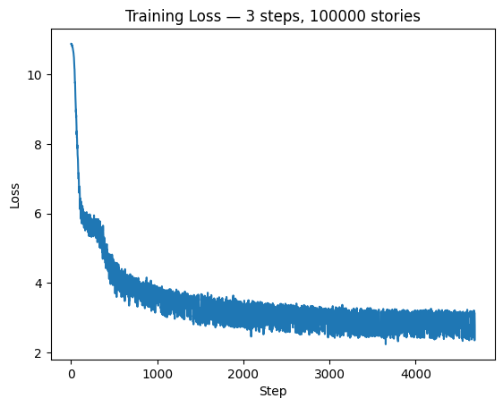

# LLM with JAX

Build, train, and run a small GPT-style language model from scratch with **JAX** and **Flax NNX**.

This project implements a ~20M-parameter decoder-only transformer trained on [TinyStories](https://huggingface.co/datasets/roneneldan/TinyStories), with checkpointing, text generation, and an interactive Gradio demo.

> **Coming soon:** the trained model and demo will be published on [Hugging Face](https://huggingface.co/) (model repo + Space).

---

## Training results

Loss decreases sharply in the first steps, then stabilizes around ~3 after training on 100,000 stories:



---

## Model overview

| Spec | Value |
| --- | --- |
| Parameters | ~20.2M (~81 MB) |
| Context length | 128 tokens |
| Embedding dim | 192 |
| Attention heads | 6 |
| Transformer blocks | 6 |
| Feed-forward dim | 512 |
| Tokenizer | GPT-2 (`tiktoken`) |
| Dataset | TinyStories |

Architecture highlights:

- Token + positional embeddings
- Causal multi-head self-attention
- Residual connections
- Linear output head over the GPT-2 vocabulary

---

## Stack

- **JAX** — numerics and autodiff  
- **Flax NNX** — modular model definition  
- **Optax** — AdamW + learning-rate schedule  
- **Orbax** — checkpoint save / restore  
- **Grain** — data loading  
- **tiktoken** — tokenization  
- **Gradio** — local interactive demo  

---

## Repository layout

```text
llm-with-Jax/
├── llm-20m-params.ipynb   # end-to-end notebook (build → train → generate → demo)
├── images/
│   └── training_loss.png  # training curve
├── small_gpt.orbax/       # model checkpoint
└── README.md
```

---

## Quick start

### 1. Environment

```bash
python -m venv .venv
# Windows
.venv\Scripts\activate
# macOS / Linux
source .venv/bin/activate

pip install jax flax matplotlib tiktoken grain datasets optax orbax-checkpoint gradio
```

### 2. Open the notebook

Run `llm-20m-params.ipynb` cell by cell to:

1. Define the GPT architecture  
2. Load and tokenize TinyStories  
3. Train with Optax / Flax NNX  
4. Save checkpoints with Orbax  
5. Generate stories with `create_story(...)`  
6. Launch the Gradio UI  

### 3. Generate text

```python
create_story("Once upon a time a big bear ", temperature=0.2, max_new_tokens=30)
```

Example output:

> Once upon a time a big bear old, who lived in a big forest. He was very happy and he loved to play. One day, he saw a big, a big,

---

## Checkpointing

Weights are stored with Orbax:

```python
checkpointer = orbax.checkpoint.PyTreeCheckpointer()
checkpointer.save(checkpoint_path, nnx.state(model), force=True)
```

Restored weights live under `small_gpt.orbax/`.

---

## Hugging Face deployment (planned)

Planned next steps:

1. Upload model weights + `config.json` to a **Hugging Face model repo**  
2. Publish a **Space** with the Gradio story generator  
3. Document load / inference instructions on the model card  

Stay tuned — links will be added here once the deployment is live.

---

## Roadmap

- [x] GPT architecture in Flax NNX  
- [x] TinyStories training pipeline  
- [x] Loss monitoring & checkpoints  
- [x] Autoregressive generation  
- [x] Local Gradio demo  
- [ ] Hugging Face model + Space deployment  
- [ ] Longer context / larger model variants  

---

## License

This project is provided for learning and experimentation. Dataset terms follow [TinyStories](https://huggingface.co/datasets/roneneldan/TinyStories).
